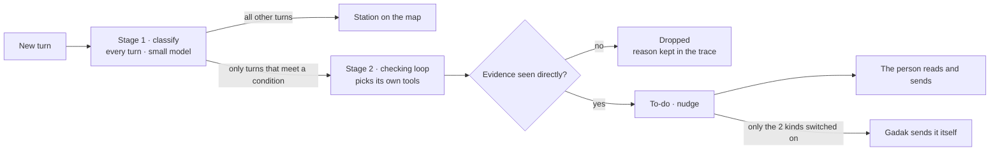

# Gadak 가닥

**An agent that redraws long LLM chats as a transit map and tells you first about what slipped past**

[한국어](https://github.com/Hanhws/AI-agent/blob/main/README.md) · [Site](https://hanhws.github.io/AI-agent/en/) · [Try it without installing](https://hanhws.github.io/AI-agent/en/demo/) · [Download (macOS · Windows)](https://hanhws.github.io/AI-agent/en/download/)


A team project for the AI applications course of the SNU Big Data & FinTech programme (KDT), cohort 13. Category C: an AI agent app for work, with the workflow compared before and after AI.

> To look without installing, open the [demo](https://hanhws.github.io/AI-agent/en/demo/). It runs the real Gadak window on a made-up conversation.

## 1. At a glance

| | |
|---|---|
| Problem | A chat piles up in one line, but work branches as it goes. Side questions, decisions and files get buried in the scroll |
| Answer | Gadak sits beside the chat, reads the flow and draws it as a transit map. One question is one station, a decision is a large dot, a side trip is a grey branch, and a red dot marks where you are |
| Agent | Every turn passes once through a cheap classification. Only the turns that meet a condition start a checking loop that picks its own tools. Gadak lists only what it saw evidence for, and keeps a decision trace |
| The person's place | Gadak never answers for the model. It drafts the message and hands it over, and sends by itself only the 2 kinds you switch on |
| Reads from | Claude Code · Codex (automatic) · Cursor (connect once) · Claude and ChatGPT on the web (Chrome extension) · export files |
| What we shipped | A macOS app and a Windows installer (Korean and English editions, 8 installer files) · a Chrome extension · a site with a live demo · 385 tests |

## 2. Why we built it

The better you follow the habits the course teaches (split the context, inspect every answer, number your requests), the more manual work is left over. A survey of 17 people (2 October 2026; 16 of them use an LLM several times a day) showed where.

| Group | Symptom | Of 17 |
|---|---|---|
| The flow is invisible | After a side question, getting back means scrolling up and rereading | 15 have had it |
| Files scatter | Every fix makes a v2 and a v3, and places nobody asked about change too | Often or more: unsure which version is the latest 8 · unrequested changes 7 |
| To-dos leak | Several things were asked and only some were answered | 10 have had it |
| The cost of splitting chats | The old chat cannot be found, so the question is asked again, and context is summarised by hand to move it | 9 · 12 |

Existing tools (ChatGPT's branching, tree extensions) only draw the structure, or make the user do the splitting. Nothing reads what the conversation means and makes the call. That gap is where Gadak starts. The sample is 17 people, mostly heavy users, so we do not generalise from it. The full analysis is in [`docs/survey/설문분석.md`](docs/survey/설문분석.md) (in Korean).

## 3. What Gadak does

<p>


</p>

| Feature | What it does |
|---|---|
| A chat as a map | One question is one station. Click a station to jump to that point in the chat |
| Missed work, first | A missed request, an unrequested change, the context to carry on: Gadak rereads the record, verifies, and only then adds a to-do |
| A month on one sheet | The system map draws every project as a coloured line over the last 7, 15 or 30 days |
| Over the app you are in | On macOS a Gadak button at the edge of the screen opens the map of your current chat |
| Look ahead | Gadak reads what you are about to do, searches past records and the documents in the working folder, and offers up to 3 ways forward. They are questions to take to your LLM, not answers |


## 4. The workflow, before and after

We split each job into steps, marked the bottlenecks and decided where Gadak takes over. The numbers come from one team member's real records (31 chats · 416 turns · 3 September to 12 October), measured again with [`eval/replay.py`](eval/replay.py). They are amounts a person has to read or type, not times taken with a stopwatch.

**Job A: fixing code with a coding agent**

| Step | Before (the agent alone) | After (with Gadak) | What the person does |
|---|---|---|---|
| Check the result | Skim the whole diff and sort what was asked from what was not | Gadak compares the request with the changed lines and points only at unrequested changes | Verify the places it flagged |
| Undo | Recall what it used to be and write the undo request by hand | One click on "Ask to undo". Once switched on, Gadak sends it itself | Approve the first time |
| Pick up the next day | Explain past decisions and context again in a new chat | When a new chat opens, Gadak offers a summary of what was decided | Decide whether to add it |

| Measured | Before | After |
|---|---|---|
| Lines to skim to find unrequested changes | 3,244 lines | the 7 places Gadak flagged |
| Characters typed for an undo request | 106 | 0 (Gadak wrote and sent it · 3 times) |

**Job B: writing a report or a slide deck over several days**

| Step | Before (chat alone) | After (with Gadak) | What the person does |
|---|---|---|---|
| Get back to the main flow | Scroll up and reread, or ask again | Click a station on the map | Pick the station |
| Find the latest version and past decisions | Dig through folders and chats and guess | "Latest" under Files, and the Decided list | — |
| Move to a new chat | Summarise the context by hand and paste it | "Paste summary" under Carry on adds what was decided | Decide whether to paste |

| Measured | Before | After |
|---|---|---|
| Lines to scroll back to a past decision (median of 45) | 388 lines | 1 click on a station |
| Versions of the same file | 2 to 4 | the latest 1 |
| Context to move into a new chat | 20,839 characters | a 585-character Gadak summary (11 times) |

## 5. Agent design



| Stage | When | What it does |
|---|---|---|
| Stage 1 · classify | Every turn | Splits requests, tells the main line from a side trip, marks decisions, names stations and sections, condenses the answer. A small model (Haiku) is asked about up to 8 turns in one call |
| Stage 2 · check | Files changed more widely than asked · a request that looks unanswered · a new chat opens | Picks tools, reads what they return and decides whether to look further or stop. A conclusion whose evidence it did not see through a tool is dropped |
| Look ahead | When the user clicks "Look ahead" | Searches decisions, open to-dos and working-folder documents first, then a larger model (Sonnet) chooses what else to read |

| Tool | Reads |
|---|---|
| `get_request` · `get_diff` | The turn's original request and its answer · the changed files and lines |
| `search_decisions` · `list_open_items` | What the project has decided · the to-dos still open |
| `search_turns` · `list_files` · `search_files` · `read_file` · `look_up` | Past questions and answers · text files in the working folder · the web (only when switched on). Used by Look ahead only |

**Autonomy is set on a scale.** We separated what Gadak does alone from what the person decides.

| Level | What Gadak does |
|---|---|
| On its own | Reads chats, sorts them, checks for missed work |
| Prepares only | Drafts the message of a nudge and hands it over. The user sends it |
| Itself, once approved | Undoing an unrequested change · adding a summary to carry on. Only the kinds the user switched on |
| Never | Answering · sending any other message · sending chat text to the Gadak team's server |

In the same 416 turns the checking loop ran on 64 turns (15%). The records show 7 tools chosen in 14 different orders. 24 runs produced a to-do, 40 ended with nothing to report, and 3 findings were dropped for lack of evidence. Every step is kept in the decision trace (`/trace`).

## 6. How accurate it is and what it costs

We ran `python -m eval` on 55 turns of a real conversation that had been labelled with the right answers. The run logs are in [`eval/results/`](eval/results).

| Metric (Haiku · 4 runs) | Value | How to read it |
|---|---|---|
| Finding side trips (recall) | 60–70% | It finds 6 or 7 of 10 side trips |
| Splitting requests (count match) | 80–86% | It splits 10 or 11 of the 11 turns that hold several requests |
| Station depth accuracy | 80–84% | Answering "all main line" would score 82%, so we do not quote this number |
| Finding decisions | 30–70% | It swings from run to run. Not reliable yet |

| Cost | Value |
|---|---|
| One automatic sort | about 1 cent (0.3 to 0.5 cents a turn, converted to API prices) |
| What Gadak adds to my own Claude usage | 2–3% (real records, 7 to 12 October) |
| One Look ahead | 6 to 17 cents · about 0.7% of a Claude Pro 5-hour limit, which is why looking ahead on its own is off by default |

A larger model (Sonnet) was not better. It found every side trip but called twice as many turns side trips, and it cost $0.34. So the every-turn sorting stays on the small model. One person labelled one person's conversation, so we do not generalise these numbers. They were measured with the Korean prompts.

## 7. Structure and stack

```
[Claude Code · Codex]         session files ──────┐
[Cursor]                      hooks ──────────────┼─▶ backend (Python · Flask · 127.0.0.1:7311 on your computer)
[Claude · ChatGPT on the web] Chrome extension ───┤     ├─ sources/  find and read the records
[Export files]                import ─────────────┘     ├─ agent/    stage 1 classify · stage 2 checking loop · look ahead · decision trace
                                                        ├─ engines/  Claude subscription · ChatGPT subscription · LLM API key
                                                        └─ store.py  one SQLite file (~/.gadak/gadak.db)
        screens (shared/ui · plain JS, no framework)  ◀── map · to-dos · nudges
        the Gadak window · the macOS app and floating button · the Windows window · the demo on the site
```

| Layer | Used |
|---|---|
| Backend | Python 3.14 · Flask · SQLite. There is no separate server or database. Chats are stored only on your computer, and only while sorting does part of a turn go to the AI you connected |
| LLM | Claude subscription (`claude -p`) · ChatGPT subscription (`codex exec`) · the Anthropic, OpenAI and Gemini APIs. The answer format is fixed with a JSON schema |
| Screens | Plain JS and CSS, no framework. The line grammar is borrowed from Massimo Vignelli's 1972 New York subway map |
| Apps | macOS: Swift (AppKit · WKWebView) with PyInstaller. Windows: embeddable Python with NSIS |
| Web entry | A Chrome extension (Manifest V3). It sends only to Gadak on your own computer |

| Folder | What |
|---|---|
| [`backend/`](backend) | The backend. `agent/` (the agent) · `engines/` (LLMs) · `sources/` (reading records) · `prompts/` (6 prompts) · `web/` (the Gadak window) |
| [`shared/ui/`](shared/ui) | The screens every entry shares (map · lists · nudges) |
| [`mac/`](mac) · [`win/`](win) | The macOS app shell and floating button · the Windows installer |
| [`extension/`](extension) · [`cursor-hooks/`](cursor-hooks) | The Chrome extension · hooks for Cursor and Claude Code |
| [`eval/`](eval) · [`tests/`](tests) | Accuracy and before/after measurement · the tests |
| [`data/`](data) | The made-up example conversation used by the demo and the screenshots |
| [`homepage/`](homepage) | The source of the site (Korean · English) |
| [`server/`](server) | A server that receives usage records only from users who agreed. It takes numbers and fixed words, never chat text. The downloadable app sends nothing to it |
| [`docs/`](docs) | Design spec · development log · guides · survey · slides |
| [`archive/`](archive) · [`prototype/`](prototype) | Material from when the project was called "Gallae" · symbol drafts |

## 8. Run and test

To use Gadak, get the file for your computer from the [download page](https://hanhws.github.io/AI-agent/en/download/). The illustrated guide is [`docs/gadak-install-guide.pdf`](docs/gadak-install-guide.pdf) and the full guide is [`docs/usage-guide.en.md`](docs/usage-guide.en.md).

To run from source, start at the top of the tree of the edition you want (see section 9).

```bash
python3 -m venv .venv && .venv/bin/python -m pip install -r requirements.txt
.venv/bin/python -m backend.launch                 # opens the Gadak window. Add ?demo to the address for the made-up example
.venv/bin/python -m unittest discover -s tests     # 385 tests (Korean edition) · 387 (English edition)
.venv/bin/python -m eval                           # measures accuracy (on a computer that has the labelled conversation)
```

On a Mac, double-clicking `Install Gadak.command` (English edition) or `가닥 설치.command` (Korean edition) builds the app and puts it in Applications.

## 9. Two editions

The code is the same and only the language differs: the screens, the prompts, the made-up example and the install guide. In the English edition the station names and summaries Gadak writes are in English whatever language you chat in.

| | Korean edition | English edition |
|---|---|---|
| Code | the top of the `main` branch | the [`english/`](https://github.com/Hanhws/AI-agent/tree/main/english) folder on `main`, a copy of the `english` branch |
| App | `가닥.app` | `Gadak.app` |
| Download | [site](https://hanhws.github.io/AI-agent/download/) · release `v0.1.0` | [site](https://hanhws.github.io/AI-agent/en/download/) · release `v0.1.0-en` |
| Tests | 385 | 387 |

Both editions can be installed side by side, but they share the same records (`~/.gadak`) and port, so run one at a time. Changes to the English edition are made on the `english` branch, and the folder is refreshed from it ([`docs/handoff-english.md`](docs/handoff-english.md), in Korean).

## 10. Not done yet

| Item | State |
|---|---|
| Windows version | Checked only under Wine on a Mac. It has never been started on a real Windows PC |
| Cursor · ChatGPT on the web · export files | Built, but not checked end to end in the real environment. Claude Code and Claude on the web were checked |
| Chats in desktop and mobile apps | Gadak cannot read them directly. They come in through an export file |
| LLM API keys | Checked against the real servers only as far as rejecting a wrong key. Sorting with a real key was not tried |
| Accuracy | 55 turns of one person's conversation. The rule for a decision needs refining and measuring again. Nothing was measured with the English prompts |
| Other computers | Opening the app on a clean Mac and on a real Intel Mac was not checked |
| Not built | A map attached beside web chats · an MCP server for Claude Desktop · a view that folds turns |

## 11. Documents

| Document | What |
|---|---|
| [`docs/spec.md`](docs/spec.md) | Design spec (in Korean): problem definition · agent loop · workflow comparison · design rules · decision log |
| [`docs/CHANGES.md`](docs/CHANGES.md) · [`docs/changes-detail.md`](docs/changes-detail.md) | Development log by date (in Korean · short and long) |
| [`docs/usage-guide.en.md`](docs/usage-guide.en.md) · [`docs/gadak-install-guide.pdf`](docs/gadak-install-guide.pdf) | How to use Gadak · the illustrated install guide |
| [`docs/schema.md`](docs/schema.md) · [`docs/agent-prompt.md`](docs/agent-prompt.md) · [`backend/prompts/`](backend/prompts) | Data contract · prompt design (in Korean) · the prompts themselves |
| [`docs/survey/`](docs/survey) | The questionnaire and its analysis (in Korean; raw responses are not published) |
| [`docs/design/slides/`](docs/design/slides) | The presentation deck (HTML, in Korean; download it and open it in a browser) |
| [`CLAUDE.md`](CLAUDE.md) | The working rules given to the coding agent (in Korean) |

## 12. Who made it

| Role | Work |
|---|---|
| Planning lead | Problem definition · survey · design · prompt wording · English edition · presentation |
| Implementation lead | Backend and agent · Chrome extension · hooks · Mac and Windows apps · evaluation · release |
| Coding agent | Claude Code. It wrote code and tests inside the rules we set ([`CLAUDE.md`](CLAUDE.md)) |

Every screenshot and the demo use a made-up conversation. Gadak is a student project and is not affiliated with Anthropic, OpenAI or Google.
