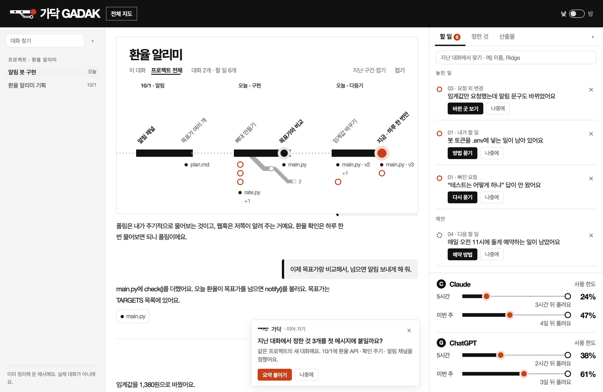
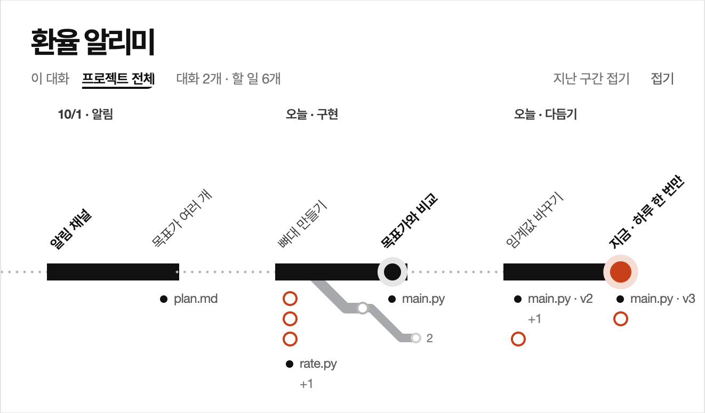
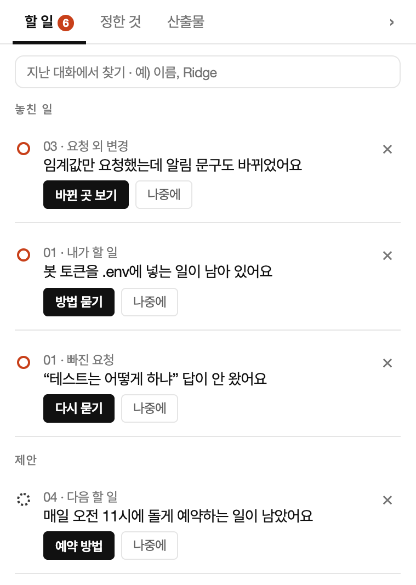
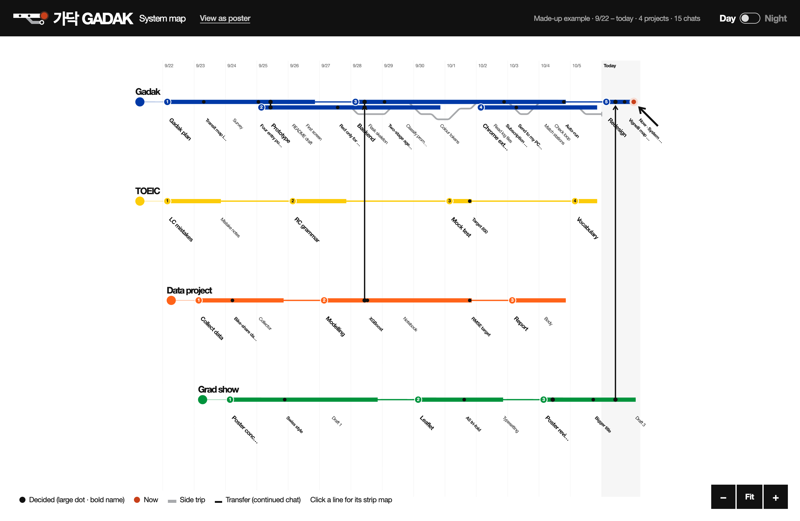
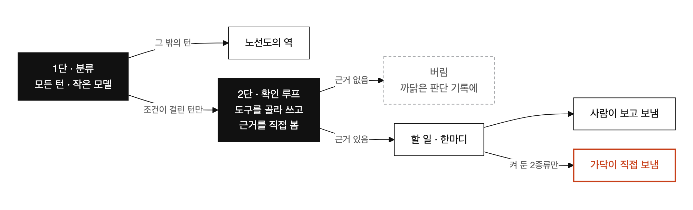
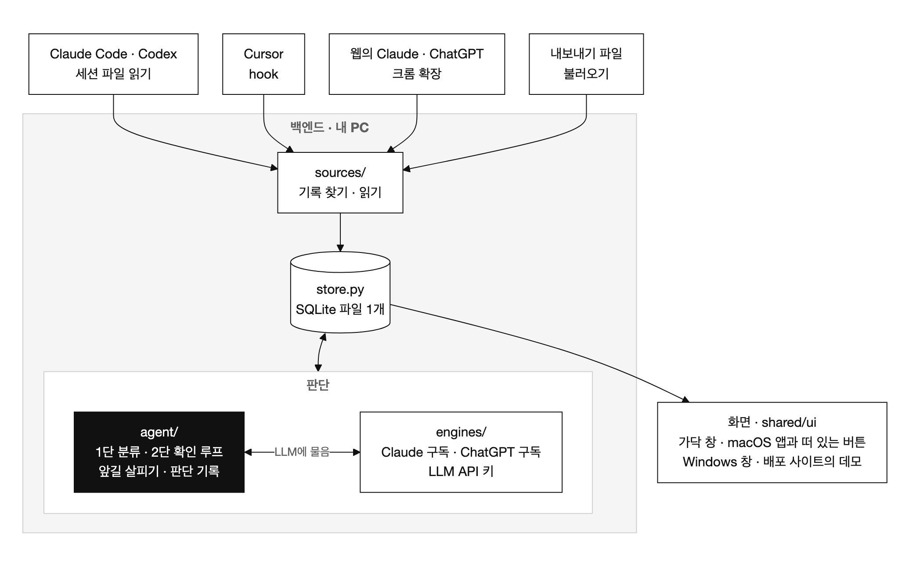

# 가닥 GADAK

**긴 LLM 대화를 지하철 노선도로 정리하고, 놓친 일을 먼저 알려 주는 에이전트**

[English](README.en.md) · [소개 사이트](https://hanhws.github.io/AI-agent/) · [설치 없이 눌러 보기](https://hanhws.github.io/AI-agent/demo/) · [받기 (macOS · Windows)](https://hanhws.github.io/AI-agent/download/)



SNU 빅데이터 핀테크 과정(KDT) 13기 · AI 응용사례 수업의 팀 과제예요. Category C — 업무용 AI Agent 앱, AI 적용 전후의 workflow 비교.

> 설치 없이 보려면 [데모](https://hanhws.github.io/AI-agent/demo/)를 눌러 보세요. 만든 예시 대화로 실제 가닥 화면이 그대로 떠요.

## 1. 한눈에

| 항목 | 내용 |
|---|---|
| 문제 | 채팅은 한 줄로 쌓이는데 일은 가지를 치며 진행돼요. 곁길 질문 · 결정 · 산출물이 스크롤 속에 묻혀요 |
| 해결 | 가닥이 대화 옆에서 흐름을 읽어 노선도로 그려요. 질문 하나가 역, 결정은 큰 점, 곁길은 회색 지선, 지금은 빨간 점이에요 |
| 에이전트 | 모든 턴이 값싼 분류를 1번 거쳐요. 조건이 걸린 턴에서만 도구를 골라 쓰는 확인 루프가 돌아요. 근거를 직접 본 것만 할 일로 올리고, 판단 기록을 남겨요 |
| 사람의 자리 | 가닥은 대답하지 않아요. 보낼 글을 준비해 건네고, 사용자가 켠 2종류만 직접 보내요 |
| 읽는 곳 | Claude Code · Codex(켜면 알아서) · Cursor(한 번 연결) · 웹의 Claude와 ChatGPT(크롬 확장) · 내보내기 파일 |
| 결과물 | macOS 앱과 Windows 설치판(한국어판 · 영어판, 설치 파일 8개) · 크롬 확장 · 배포 사이트와 데모 · 테스트 385개 |

## 2. 왜 만들었나

수업에서 배운 좋은 습관(맥락을 나눠라 · 응답을 잘 살펴라 · 요청을 번호로 구분하라)을 지킬수록 사람 손이 드는 일이 남아요. 설문 17명(2026-10-02 · 하루 여러 번 쓰는 사용자 16명)에서 그 자리를 확인했어요.

| 묶음 | 증상 | 설문 17명 |
|---|---|---|
| 흐름이 안 보인다 | 곁길 질문 뒤 원래 흐름으로 돌아가려면 위로 스크롤해 다시 읽어요 | 15명이 겪음 |
| 산출물이 흩어진다 | 고칠 때마다 v2 · v3가 생기고 요청하지 않은 곳까지 바뀌어요 | ‘자주’ 이상: 최신본 혼동 8명 · 요청 외 변경 7명 |
| 할 일이 샌다 | 여러 개를 물었는데 일부만 답이 와요 | 10명이 겪음 |
| 나눠 쓰는 비용 | 지난 대화를 못 찾아 새로 묻고, 맥락을 손으로 요약해 옮겨요 | 9명 · 12명 |

기존 도구(ChatGPT의 분기, 트리 확장)는 구조만 그리거나 사용자가 직접 갈라야 해요. 대화의 뜻을 읽고 판단하는 주체가 없다는 것이 가닥의 출발점이에요. 표본은 17명이고 많이 쓰는 사용자 중심이라 일반화하지 않아요. 분석 전체는 [`docs/survey/설문분석.md`](docs/survey/설문분석.md)에 있어요.

## 3. 가닥이 하는 일

<p>


</p>

| 기능 | 하는 일 |
|---|---|
| 대화를 노선도로 | 질문 하나가 역 하나예요. 역을 누르면 그 대화의 그 자리로 가요 |
| 놓친 일 먼저 알림 | 빠진 요청 · 요청 외 변경 · 이어 가기를 기록을 다시 읽어 확인한 뒤 할 일에 올려요 |
| 한 달을 한 장에 | 프로젝트마다 색이 다른 노선으로 최근 7 · 15 · 30일을 그리는 전체 지도예요 |
| 쓰던 앱 위에서 | macOS에서는 화면 가장자리의 가닥 버튼이 지금 대화의 노선도를 띄워요 |
| 앞길 살피기 | 하려는 일을 읽고 지난 기록 · 작업 폴더의 문서를 찾아, 갈 수 있는 길을 3개까지 내밀어요. 답이 아니라 LLM에게 가져갈 물음이에요 |



## 4. 업무 흐름: 전과 후

업무 하나를 단계로 쪼개고, 병목을 표시하고, 가닥이 맡는 곳을 정했어요. 숫자는 팀원 1명의 실제 기록(대화 31개 · 416턴 · 9/3~10/12)을 [`eval/replay.py`](eval/replay.py)로 다시 잰 값이에요. 스톱워치로 잰 시간이 아니라 사람이 읽거나 쳐야 하는 양이에요.

**업무 A — 코딩 에이전트로 코드 고치기**

| 단계 | 전 (에이전트만) | 후 (가닥과 함께) | 사람이 하는 일 |
|---|---|---|---|
| 결과 확인 | 바뀐 파일 전체를 diff로 훑어 요청한 것과 아닌 것을 직접 가려요 | 요청과 바뀐 줄을 대조해 요청 외 변경만 짚어요 | 짚어 준 곳만 검증 |
| 되돌리기 | 무엇이 원래였는지 떠올려 되돌리기 요청을 직접 써요 | ‘원래대로 요청’ 1번. 켜 두면 가닥이 직접 보내요 | 처음 1번 승인 |
| 다음 날 이어 하기 | 새 대화에 지난 결정과 맥락을 다시 설명해요 | 새 대화가 열리면 정한 것 요약을 내밀어요 | 넣을지 결정 |

| 잰 것 | 전 | 후 |
|---|---|---|
| 요청 외 변경을 찾으려 훑을 줄 | 3,244줄 | 가닥이 짚은 7곳 |
| 되돌리기 요청을 직접 치는 글자 | 106자 | 0자 (가닥이 써서 보냄 · 3번) |

**업무 B — 여러 날에 걸친 보고서 · 발표 자료 만들기**

| 단계 | 전 (채팅만) | 후 (가닥과 함께) | 사람이 하는 일 |
|---|---|---|---|
| 원래 흐름으로 복귀 | 위로 스크롤해 다시 읽거나 다시 물어요 | 노선도의 역을 눌러요 | 돌아갈 역 고르기 |
| 최신본 · 지난 결정 찾기 | 폴더와 대화를 뒤지며 추측해요 | 산출물의 ‘최신’, ‘정한 것’ 목록에서 찾아요 | — |
| 새 대화로 옮기기 | 맥락을 직접 요약해 붙여요 | ‘이어 가기’의 ‘요약 붙이기’로 정한 것을 붙여요 | 붙일지 결정 |

| 잰 것 | 전 | 후 |
|---|---|---|
| 지난 결정까지 스크롤할 줄 (45개의 중간값) | 388줄 | 역 누르기 1번 |
| 같은 파일의 버전 | 2~4개 | 최신 1개 |
| 새 대화로 옮길 맥락 | 20,839자 | 가닥 요약 585자 (11번) |

## 5. 에이전트 설계



| 단계 | 언제 | 하는 일 |
|---|---|---|
| 1단 · 분류 | 모든 턴 | 요청 나누기 · 본선과 곁길 · 정함 · 역 이름과 구간 · 답 간추림. 작은 모델(Haiku)에 턴을 8개까지 묶어 1번에 물어요 |
| 2단 · 확인 | 파일이 요청보다 넓게 바뀜 · 빠진 것 같은 요청 · 새 대화가 열림 | 도구를 골라 쓰고, 결과를 보고 더 볼지 끝낼지 정해요. 근거를 도구로 직접 보지 않은 결론은 버려요 |
| 앞길 살피기 | 사용자가 ‘앞길 보기’를 누를 때 | 정한 것 · 열린 할 일 · 작업 폴더 문서를 먼저 찾고, 큰 모델(Sonnet)이 더 읽을 것을 골라요 |

| 도구 | 읽는 것 |
|---|---|
| `get_request` · `get_diff` | 그 턴의 요청 원문과 답 · 바뀐 파일과 줄 |
| `search_decisions` · `list_open_items` | 프로젝트의 정한 것 · 열려 있는 할 일 |
| `search_turns` · `list_files` · `search_files` · `read_file` · `look_up` | 지난 물음과 답 · 작업 폴더의 글 파일 · 웹(따로 켰을 때만). 앞길 살피기만 써요 |

**자율성은 눈금으로 정했어요.** 가닥이 혼자 하는 일과 사람이 정하는 일을 나눴어요.

| 눈금 | 가닥이 하는 일 |
|---|---|
| 알아서 | 대화 읽기 · 정리 · 놓친 일 확인 |
| 준비만 | 한마디의 보낼 글을 써서 건네요. 보내기는 사용자가 해요 |
| 승인하면 직접 | 요청 외 변경 되돌리기 · 이어 가기 요약 넣기. 사용자가 켠 종류만이에요 |
| 하지 않음 | 대답하기 · 그 밖의 글 보내기 · 대화 글을 가닥 팀 서버로 보내기 |

같은 기록 416턴에서 확인 루프가 돈 턴은 64턴(15%)이에요. 기록에 남은 도구는 7가지, 고른 순서는 14가지였어요. 24번은 할 일을 냈고, 40번은 낼 것이 없다고 끝냈고, 3개는 근거가 없어 버렸어요. 걸음마다 판단 기록(`/trace`)에 남아요.

## 6. 얼마나 맞고 얼마나 드나

정답을 단 실제 대화 55턴에 `python -m eval`을 돌려 견줬어요. 실행 기록은 [`eval/results/`](eval/results)에 있어요.

| 지표 (Haiku · 4번) | 값 | 읽는 법 |
|---|---|---|
| 곁길 찾기 (재현율) | 60\~70% | 곁길 10개 중 6\~7개를 찾아요 |
| 요청 나누기 (개수 일치) | 80\~86% | 요청이 여럿인 11턴 중 10\~11턴을 나눠요 |
| 역 깊이 정확도 | 80~84% | 전부 본선이라고 답해도 82%라서 이 숫자로는 말하지 않아요 |
| ‘정함’ 찾기 | 30~70% | 실행마다 흔들려요. 아직 믿을 만하지 않아요 |

| 비용 | 값 |
|---|---|
| 자동 정리 1번 | 약 1센트 (턴 하나에 0.3~0.5센트 · API 요금으로 환산) |
| 내 Claude 사용 대비 가닥이 더 쓰는 양 | 2\~3% (10/7\~10/12 실제 기록) |
| 앞길 보기 1번 | 6~17센트 · Claude Pro 5시간 한도의 0.7%쯤. 그래서 저절로 살피기는 기본이 꺼져 있어요 |

큰 모델(Sonnet)은 더 낫지 않았어요. 곁길을 다 찾지만 2배로 많이 곁길이라고 했고 값은 $0.34였어요. 그래서 매 턴 정리는 작은 모델로 정했어요. 정답은 1명이 단 1명의 대화라서 이 숫자를 일반화하지 않아요.

## 7. 구조와 기술



| 층 | 쓴 것 |
|---|---|
| 백엔드 | Python 3.14 · Flask(내 PC의 `127.0.0.1:7311`) · SQLite(파일 1개 · `~/.gadak/gadak.db`). 따로 둔 서버나 DB가 없어요. 대화는 내 PC에만 저장되고, 정리할 때만 그 턴의 일부가 내가 연결한 AI로 나가요 |
| LLM | Claude 구독(`claude -p`) · ChatGPT 구독(`codex exec`) · Anthropic · OpenAI · Gemini API. 답의 형식은 JSON 스키마로 정해 받아요 |
| 화면 | 프레임워크 없는 JS와 CSS. 노선 문법은 마시모 비녤리의 1972년 뉴욕 지하철 지도에서 가져왔어요 |
| 앱 | macOS는 Swift(AppKit · WKWebView)와 PyInstaller, Windows는 embeddable Python과 NSIS |
| 웹 입구 | 크롬 확장(Manifest V3). 보내는 곳은 내 PC의 가닥 하나뿐이에요 |

| 폴더 | 무엇 |
|---|---|
| [`backend/`](backend) | 백엔드. `agent/`(에이전트) · `engines/`(LLM) · `sources/`(기록 읽기) · `prompts/`(프롬프트 6개) · `web/`(가닥 창) |
| [`shared/ui/`](shared/ui) | 모든 입구가 같이 쓰는 화면 (노선도 · 목록 · 한마디) |
| [`mac/`](mac) · [`win/`](win) | macOS 앱의 겉과 떠 있는 버튼 · Windows 설치 프로그램 |
| [`extension/`](extension) · [`cursor-hooks/`](cursor-hooks) | 크롬 확장 · Cursor와 Claude Code의 hook |
| [`eval/`](eval) · [`tests/`](tests) | 정확도와 전후 재기 · 테스트 385개 |
| [`data/`](data) | 만든 예시 대화 (데모와 화면 그림에 쓰는 것) |
| [`homepage/`](homepage) | 배포 사이트의 원본 (한국어 · 영어) |
| [`english/`](english) | 영어판. `english` 브랜치를 통째로 가져다 둔 사본이에요 |
| [`server/`](server) | 동의한 사용자의 사용 기록만 받는 서버. 숫자와 정해 둔 낱말만 받고 대화 글은 받지 않아요. 받아서 쓰는 앱은 보내지 않아요 |
| [`docs/`](docs) | 설계 명세 · 개발 기록 · 쓰는 법 · 설치 안내 · 설문 · 발표 자료 |
| [`archive/`](archive) · [`prototype/`](prototype) | 이름이 ‘갈래’이던 때의 자료 · 심볼 시안 |

## 8. 실행과 테스트

받아서 쓰려면 [받기 쪽](https://hanhws.github.io/AI-agent/download/)에서 내 컴퓨터에 맞는 파일을 받아요. 그림이 든 설명은 [`docs/가닥-설치-안내.pdf`](docs/가닥-설치-안내.pdf)(9쪽), 전체 설명은 [`docs/usage-guide.md`](docs/usage-guide.md)에 있어요.

저장소에서 돌릴 때는 아래와 같아요.

```bash
python3 -m venv .venv && .venv/bin/python -m pip install -r requirements.txt
.venv/bin/python -m backend.launch                 # 가닥 창 열기
.venv/bin/python -m unittest discover -s tests     # 테스트 385개
.venv/bin/python -m eval                           # 정확도 재기
```

가닥 창의 주소 끝에 `?demo`를 붙이면 만든 예시가 떠요. `python -m eval`은 정답이 달린 대화가 있는 PC에서만 돌아요. macOS에서는 `가닥 설치.command`를 더블클릭하면 가닥 앱이 응용 프로그램 폴더에 생겨요.

## 9. 영어판

화면 · 프롬프트 · 만든 예시 · 설치 안내가 영어인 판이에요. 기능은 같고, 가닥이 붙이는 역 이름과 간추림도 영어로 나와요.

| | 한국어판 | 영어판 |
|---|---|---|
| 코드 | 이 브랜치의 뿌리 | [`english/`](english) 폴더 (`english` 브랜치의 사본) |
| 받는 곳 | [사이트](https://hanhws.github.io/AI-agent/download/) · 릴리스 `v0.1.0` | [사이트](https://hanhws.github.io/AI-agent/en/download/) · 릴리스 `v0.1.0-en` |
| 테스트 | 385개 | 387개 (`english/` 안에서) |

## 10. 아직 못 한 것

| 항목 | 상태 |
|---|---|
| Windows 판 | Mac의 Wine으로만 확인했어요. 진짜 Windows PC에서는 한 번도 켜 보지 못했어요 |
| Cursor · ChatGPT 웹 · 내보내기 파일 | 만들었지만 실제 환경에서 끝까지 확인하지 못했어요. Claude Code와 Claude 웹은 확인했어요 |
| 데스크톱 앱 · 모바일 앱의 채팅 | 직접 읽지 못해요. 내보내기 파일로 넣어요 |
| LLM API 키 | 틀린 키를 거절하는 것까지만 실제 서버로 봤어요. 진짜 키로 정리해 보지는 못했어요 |
| 정확도 | 1명의 대화 55턴이에요. ‘정함’의 기준을 다듬어 다시 재야 해요. 영어 프롬프트로는 재지 않았어요 |
| 다른 컴퓨터 | 깨끗한 다른 Mac과 진짜 Intel Mac에서 여는 것은 보지 못했어요 |
| 만들지 않은 것 | 웹 대화 옆에 붙는 노선도 · Claude 데스크톱 MCP · 턴을 접어 보여 주는 화면 |

## 11. 문서

| 문서 | 무엇 |
|---|---|
| [`docs/spec.md`](docs/spec.md) | 설계 명세. 문제 정의 · 에이전트 루프 · workflow 비교 · 디자인 규칙 · 결정 기록 |
| [`docs/CHANGES.md`](docs/CHANGES.md) · [`docs/changes-detail.md`](docs/changes-detail.md) | 날짜별 개발 기록 (짧은 판 · 긴 판) |
| [`docs/usage-guide.md`](docs/usage-guide.md) · [`docs/가닥-설치-안내.pdf`](docs/가닥-설치-안내.pdf) | 쓰는 법 · 그림으로 보는 설치 안내 |
| [`docs/schema.md`](docs/schema.md) · [`docs/agent-prompt.md`](docs/agent-prompt.md) · [`backend/prompts/`](backend/prompts) | 데이터 계약 · 프롬프트 설계 · 실제 프롬프트 |
| [`docs/survey/`](docs/survey) | 설문지와 분석 (원자료는 올리지 않아요) |
| [`docs/design/slides/`](docs/design/slides) | 발표 자료 (HTML · 받아서 브라우저로 열어요) |
| [`CLAUDE.md`](CLAUDE.md) | 코딩 에이전트에게 준 작업 규칙 |

## 12. 만든 사람

| 역할 | 맡은 일 |
|---|---|
| 기획 담당 | 문제 정의 · 설문 · 디자인 · 프롬프트 문구 · 영어판 · 발표 |
| 구현 담당 | 백엔드와 에이전트 · 크롬 확장 · hook · Mac과 Windows 앱 · 평가 · 배포 |
| 코딩 에이전트 | Claude Code. 정해 둔 규칙([`CLAUDE.md`](CLAUDE.md)) 안에서 코드와 테스트를 썼어요 |

화면 그림과 데모는 모두 만든 예시 대화예요. 가닥은 Anthropic · OpenAI · Google과 관계없는 학생 프로젝트예요.
